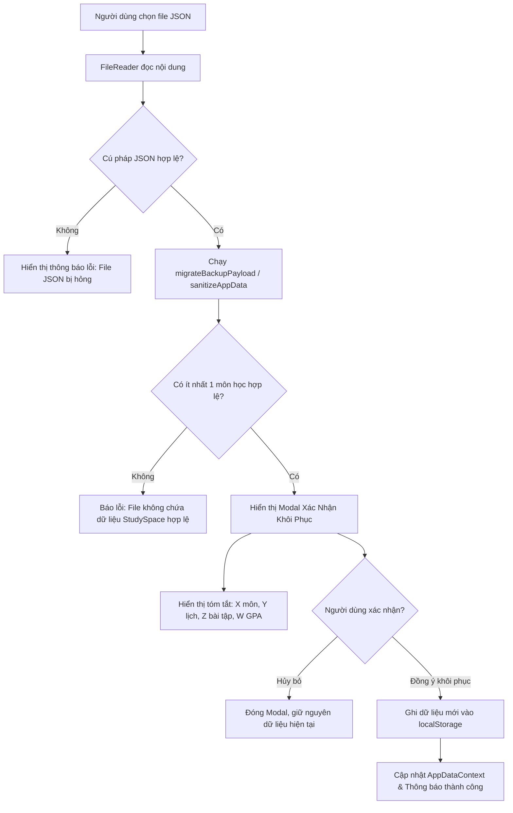

# Thiết Kế Kiến Trúc Sao Lưu & Khôi Phục Dữ Liệu (Local Data Backup & Restore)

> **Dự án:** StudySpace (DeadlineTracker)  
> **Milestone:** W1 — Post-MVP Planning & Data Architecture  
> **Nhiệm vụ:** W1 · 26/09 · Thiết kế sao lưu và khôi phục dữ liệu  
> **Người thực hiện:** Thế Đặng (`TehFine` / `dangvanthe2005@gmail.com`)  
> **Trello Card ID:** `6ade11ae9ed3ecc02728bd10`  
> **Nhánh Git:** `design/local-data-backup`  
> **Ngày lập:** 26/09/2026  
> **Phiên bản tài liệu:** 1.0  

---

## 1. Mục Tiêu & Bối Cảnh

Ứng dụng StudySpace hoạt động theo mô hình **Client-side Offline-first**, lưu trữ toàn bộ thông tin học tập của sinh viên trong `localStorage` với key `deadline-tracker:data`. 

Để bảo vệ người dùng trước các rủi ro mất mát dữ liệu (xóa cache trình duyệt, chuyển đổi máy tính cá nhân, hỏng hóc thiết bị), hệ thống cần một cơ chế sao lưu (Export) và khôi phục (Import/Restore) dữ liệu an toàn, tin cậy với các yêu cầu:
1. **Đầy đủ & Nhất quán:** Xuất toàn bộ dữ liệu (Môn học, Thời khóa biểu, Bài tập, GPA) dưới dạng có cấu trúc và có định danh phiên bản (`schemaVersion`).
2. **Linh hoạt:** Cung cấp định dạng JSON cho việc sao lưu/khôi phục hệ thống và định dạng CSV cho việc xem/báo cáo danh sách môn học, bài tập trên Excel/Google Sheets.
3. **An toàn & Chống mất mát dữ liệu:** Có cơ chế xác thực schema nghiêm ngặt, tự động xử lý khi thiếu trường dữ liệu, hiển thị tóm tắt trực quan và yêu cầu xác nhận trước khi ghi đè dữ liệu đang có.

---

## 2. Đặc Tả Định Dạng Dữ Liệu Xuất / Nhập

### 2.1. Định dạng JSON (Full System Backup Envelope)

Để hỗ trợ kiểm soát phiên bản và nâng cấp tương thích ngược trong tương lai, file sao lưu JSON không lưu trực tiếp mảng phẳng mà được đóng gói trong một **Backup Envelope**:

```typescript
export interface BackupEnvelope {
  schemaVersion: number   // Phiên bản schema (Hiện tại: 2)
  exportedAt: string      // ISO 8601 timestamp (Ví dụ: "2026-10-01T14:30:00.000Z")
  appVersion: string      // Phiên bản ứng dụng StudySpace (Ví dụ: "0.2.0")
  data: AppData           // Dữ liệu nghiệp vụ chi tiết
}
```

#### Quy chuẩn cấu trúc `AppData`:
```json
{
  "schemaVersion": 2,
  "exportedAt": "2026-10-01T14:30:00.000Z",
  "appVersion": "0.2.0",
  "data": {
    "courses": [
      {
        "id": "course-web",
        "name": "Lập trình Web",
        "teacher": "Nguyễn Minh An",
        "credits": 3,
        "color": "#6558d3"
      }
    ],
    "schedules": [
      {
        "id": "schedule-web",
        "courseId": "course-web",
        "dayOfWeek": 2,
        "startTime": "08:00",
        "endTime": "10:00",
        "room": "A2.04"
      }
    ],
    "assignments": [
      {
        "id": "assignment-web",
        "courseId": "course-web",
        "title": "Hoàn thiện responsive",
        "description": "Kiểm tra mobile 390px",
        "dueDate": "2026-10-05T23:59",
        "status": "in-progress"
      }
    ],
    "gpaEntries": [
      {
        "id": "gpa-web",
        "courseId": "course-web",
        "expectedGrade": 8.5,
        "credits": 3
      }
    ]
  }
}
```

* **Quy tắc đặt tên file JSON:** `studyspace-backup-YYYY-MM-DD.json` (ví dụ: `studyspace-backup-2026-10-01.json`).
* **MIME type:** `application/json;charset=utf-8`.

---

### 2.2. Định dạng CSV (Bảng Biểu Độc Lập)

Định dạng CSV phục vụ nhu cầu tra cứu và in ấn bảng điểm, danh sách hạn nộp. Hỗ trợ 2 bảng: **Môn học** và **Bài tập / Hạn nộp**.

#### Bảng Môn học (`studyspace-courses-YYYY-MM-DD.csv`):
* **Cột:** `ID,Tên môn học,Giảng viên,Số tín chỉ,Mã màu`
* **Ví dụ:**
  ```csv
  ID,Tên môn học,Giảng viên,Số tín chỉ,Mã màu
  course-web,"Lập trình Web","Nguyễn Minh An",3,#6558d3
  course-db,"Cơ sở dữ liệu","Trần Thu Hà",3,#e15c8b
  ```

#### Bảng Bài tập & Hạn nộp (`studyspace-assignments-YYYY-MM-DD.csv`):
* **Cột:** `ID,Môn học,Tiêu đề,Hạn nộp,Trạng thái,Mô tả`
* **Ví dụ:**
  ```csv
  ID,Môn học,Tiêu đề,Hạn nộp,Trạng thái,Mô tả
  assignment-web,"Lập trình Web","Hoàn thiện responsive","2026-10-05 23:59","Đang làm","Kiểm tra mobile 390px"
  ```

#### Quy chuẩn kỹ thuật xuất CSV:
1. **Mã hóa UTF-8 với Byte Order Mark (BOM):** Thêm tiền tố `\uFEFF` ở đầu file để Microsoft Excel tự động nhận diện font chữ tiếng Việt không bị lỗi hiển thị.
2. **Ký tự thoát (Escaping):** Các trường chứa dấu phẩy (`,`), dấu ngoặc kép (`"`), hoặc ký tự xuống dòng (`\n`) được bao bọc trong cặp ngoặc kép `""`. Mọi ký tự `"` bên trong chuỗi được nhân đôi thành `""`.

---

## 3. Quản Lý Phiên Bản Schema & Hành Vi Xử Lý Lỗi (Validation & Fallback)

### 3.1. Ma trận phiên bản (Versioning Matrix)

| Phiên bản phát hiện | Đặc điểm | Hành vi xử lý khi Khôi phục |
|---|---|---|
| **Legacy v1 (Unversioned)** | Không có envelope bọc ngoài, là JSON chứa trực tiếp `courses`, `schedules`. | Tự động đóng gói vào Envelope v2, bổ sung trường còn thiếu (`assignments: []`, `gpaEntries: []`), lọc bỏ các record hỏng. |
| **Version 2** | Chứa `schemaVersion: 2`, `data: AppData`. | Xác thực toàn bộ record qua `schemaValidation.ts`, lọc bỏ khóa ngoại mồ côi. |
| **Version không hỗ trợ (> 2)** | `schemaVersion > 2` | Từ chối khôi phục kèm thông báo: *"Bản sao lưu được tạo từ phiên bản mới hơn. Vui lòng cập nhật ứng dụng."* |

---

### 3.2. Quy tắc xử lý khi thiếu trường hoặc sai kiểu dữ liệu

| Thực thể | Trường bị thiếu / Sai kiểu | Hành vi chuẩn hóa (Sanitization Rule) |
|---|---|---|
| **Course** | `id` rỗng hoặc thiếu | Bỏ qua bản ghi (không thể quản lý quan hệ). |
| | `name` rỗng hoặc chỉ có khoảng trắng | Bỏ qua bản ghi. |
| | `credits` không phải số hoặc `<= 0` | Gán mặc định: `3`. |
| | `color` sai định dạng hex | Gán mặc định: `#6558d3`. |
| | `teacher` thiếu | Gán chuỗi rỗng `""`. |
| **Schedule** | `courseId` không tồn tại trong `courses` | Bỏ qua bản ghi (chống dữ liệu mồ côi). |
| | `dayOfWeek` ngoài khoảng 1–7 | Bỏ qua bản ghi. |
| | `startTime` / `endTime` sai định dạng `HH:mm` | Bỏ qua bản ghi. |
| | `room` thiếu | Gán chuỗi rỗng `""`. |
| **Assignment** | `courseId` không tồn tại trong `courses` | Bỏ qua bản ghi. |
| | `title` rỗng | Bỏ qua bản ghi. |
| | `status` không thuộc `todo/in-progress/done` | Gán mặc định: `'todo'`. |
| | `dueDate` thiếu | Gán thời điểm hiện tại `new Date().toISOString()`. |
| | `description` thiếu | Gán chuỗi rỗng `""`. |
| **GpaEntry** | `courseId` không tồn tại trong `courses` | Bỏ qua bản ghi. |
| | `courseId` bị trùng với bản ghi GPA trước | Giữ lại bản ghi hợp lệ đầu tiên, bỏ qua bản ghi trùng. |
| | `expectedGrade` ngoài khoảng 0.0 – 10.0 | Kẹp giá trị vào khoảng: `Math.max(0, Math.min(10, grade))`. |
| | `credits` không hợp lệ | Đồng bộ lại theo `Course.credits`. |

---

## 4. Thiết Kế Luồng Khôi Phục & Modal Xác Nhận Ghi Đè



### 4.1. Chi tiết Modal Xác nhận (Restore Confirmation Modal)

Khi người dùng chọn file backup hợp lệ, ứng dụng **không ghi đè ngay** mà bắt buộc mở Modal xác nhận chứa:
1. **Thông tin nguồn:** Tên file, ngày xuất dữ liệu (`exportedAt`), phiên bản schema.
2. **Bảng tóm tắt số liệu (Summary Grid):**
   * Số môn học: `courses.length`
   * Số lịch học trong tuần: `schedules.length`
   * Số bài tập/hạn nộp: `assignments.length`
   * Số mục điểm GPA: `gpaEntries.length`
3. **Cảnh báo dữ liệu bị loại trừ:** Nếu có các bản ghi mồ côi hoặc sai định dạng bị loại bỏ, liệt kê tóm tắt số lượng để người dùng nắm rõ.
4. **Cảnh báo thay thế dữ liệu:** Nêu rõ *"Hành động này sẽ thay thế toàn bộ dữ liệu hiện tại trên trình duyệt này bằng dữ liệu từ bản sao lưu."*
5. **Hai nút hành động:**
   * **Hủy bỏ (Secondary Button):** Hủy toàn bộ thao tác, không thay đổi `localStorage`.
   * **Khôi phục dữ liệu (Danger/Primary Button):** Áp dụng dữ liệu mới và cập nhật trạng thái toàn hệ thống.

---

## 5. Chính Sách Bảo Toàn Dữ Liệu (Data Loss Prevention Policy)

1. **Snapshot bảo hiểm:** Trước khi thực hiện ghi đè dữ liệu mới, hệ thống tự động đọc và giữ bản sao của dữ liệu hiện hành trong bộ nhớ RAM. Nếu thao tác `setItem` gặp lỗi (ví dụ: `QuotaExceededError`), hệ thống lập tức rollback trả lại dữ liệu cũ và thông báo lỗi.
2. **Xử lý ngoại lệ lưu trữ:** Mọi thao tác ghi vào `localStorage` đều được bao bọc trong `try...catch` để bắt kịp thời các lỗi phân quyền, chế độ ẩn danh (Incognito/Private Browsing), hoặc bộ nhớ đầy.
3. **Không làm trắng dữ liệu:** File JSON rỗng hoặc hỏng tuyệt đối không được phép xóa sạch dữ liệu người dùng đang có trên máy.

---

*Tài liệu được xây dựng và nghiệm thu theo tiêu chuẩn Definition of Done của Milestone W1.*
