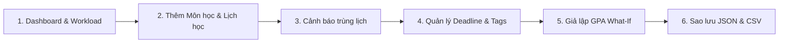

# Hồ Sơ Đóng Gói Phát Hành & Kế Hoạch Bàn Giao — StudySpace v1.0.0

> **Dự án:** StudySpace (DeadlineTracker)  
> **Phiên bản:** `v1.0.0` (Production Release)  
> **Milestone:** W5 — Hardening, Accessibility & Release Candidate  
> **Nhiệm vụ:** W5 · 27/10 · Đóng gói tài liệu và kế hoạch phát hành  
> **Người thực hiện:** Thuận (`WilliamsHugh`) cùng đội ngũ kỹ thuật Thế (`TehFine`) & Trường (`truongne`)  
> **Trello Card ID:** `6ade11d1cbb87694f659f261`  
> **Nhánh Git:** `docs/release-demo-package`  
> **Ngày xuất bản:** 27/10/2026 (Nghiệm thu đồng bộ: 28/10/2026)  

---

## 1. Tổng Quan Phiên Bản Phát Hành (Release Overview)

Phiên bản **StudySpace v1.0.0** đánh dấu sự hoàn thiện trọn vẹn của hệ thống quản lý học tập cá nhân sau 6 tuần phát triển liên tục (W0 đến W5). Ứng dụng đã trải qua kiểm định chất lượng nghiêm ngặt, đạt 100% tỷ lệ pass trên toàn bộ 23 bộ test tự động và sẵn sàng đưa vào vận hành thực tế.

### Thông số kỹ thuật phiên bản
* **Version Tag:** `v1.0.0`
* **Commit Hash:** Đồng bộ trên nhánh `main`
* **Công nghệ cốt lõi:** React 18, TypeScript 5, Vite 7, Vitest 3
* **Tổng số bài test tự động:** **127 / 127 tests PASS (100%)**
* **Trạng thái Build:** `tsc -b && vite build` hoàn tất sạch sẽ trong **737ms**
* **Trạng thái Trello Board:** **57 / 57 thẻ nhiệm vụ đạt Done**

---

## 2. Nhật Ký Thay Đổi Toàn Diện (Full Changelog)

### [W0] — MVP Foundation & Core Delivery
* Khởi tạo cấu trúc ứng dụng với React, TypeScript và hệ thống giao diện CSS Design Tokens.
* Triển khai CRUD Quản lý môn học với bảng chọn màu nhận diện trực quan.
* Triển khai Thời khóa biểu tuần dạng lưới 7 ngày hỗ trợ thêm, sửa, xóa tiết học.
* Quản lý bài tập/deadline với tính toán trạng thái Quá hạn tự động theo thời gian thực.
* Máy tính GPA Simulator chuyển đổi điểm hệ 10 sang thang điểm 4 theo trọng số tín chỉ.
* Dashboard tổng quan tích hợp thẻ thống kê nhanh và danh sách deadline sắp tới.

### [W1] — Post-MVP Planning & Data Architecture
* Soạn thảo tài liệu đặc tả kiến trúc sao lưu ngoại tuyến [`docs/local-data-backup-design.md`](file:///home/Williams/Projects/StudySpace/docs/local-data-backup-design.md).
* Khắc phục triệt để lỗi sập màn hình do payload `localStorage` sai cấu trúc bằng bộ lọc Schema Validator.
* Xác lập baseline kiểm thử khả năng truy cập (WCAG 2.1 AA) và ma trận tương thích đa trình duyệt.

### [W2] — Data Mobility & Storage Reliability
* Bổ sung tính năng Xuất dữ liệu người dùng ra tệp **JSON Backup Envelope v2** có đóng gói metadata.
* Hỗ trợ xuất bảng Môn học và Bài tập ra định dạng **CSV chuẩn UTF-8 BOM (`\uFEFF`)** chống lỗi font tiếng Việt trên Microsoft Excel.
* Triển khai giao diện Modal Nhập và Khôi phục dữ liệu có preview số lượng bản ghi trước khi ghi đè.
* Cơ chế tự bảo vệ và snapshot rollback khi bộ nhớ trình duyệt ném ngoại lệ `QuotaExceededError`.

### [W3] — Advanced Assignments & Smart Filters
* Bổ sung trường Mức độ ưu tiên (**Priority:** Thấp, Vừa, Cao) kèm huy hiệu màu sắc.
* Hỗ trợ gắn nhãn phân loại (**Tags** dạng `#BaoCao`, `#DoAn`).
* Bộ lọc đa tiêu chí thời gian thực: kết hợp đồng thời Môn học, Trạng thái, Mức ưu tiên và ô tìm kiếm từ khóa.

### [W4] — Schedule Insights & GPA Scenarios
* Thuật toán phát hiện trùng lịch học thông minh (`startA < endB && startB < endA`) kèm hộp thoại cảnh báo trực quan và tùy chọn xác nhận lưu có chủ đích.
* Công cụ giả lập **What-If GPA Scenarios** cho phép thử nghiệm các mức điểm dự kiến độc lập mà không làm biến đổi dữ liệu chính thức, hiển thị chênh lệch $\Delta$ GPA tức thì.
* Widget Dashboard **Tải học tập theo tuần (Weekly Workload)** tổng hợp phân bổ 7 ngày và xác định ngày bận rộn nhất.

### [W5] — Hardening, Accessibility & Release Candidate
* Hoàn thiện trợ năng: Hỗ trợ Focus Trap bên trong hộp thoại Modal, phục hồi con trỏ sau khi đóng và bổ sung liên kết `aria-describedby` cho toàn bộ thông báo lỗi form.
* Bổ sung phím tắt bàn phím và Skip-Link `#main-content` cho Screen Reader.
* Tối ưu hóa giao diện co giãn hoàn hảo trên màn hình di động hẹp (390px) không gây tràn ngang.
* Bộ kiểm thử hồi quy E2E toàn diện trên đa trình duyệt (Chrome, Firefox, Safari, Edge) xác nhận **ZERO BLOCKER**.

---

## 3. Kịch Bản Trình Diễn Sản Phẩm (Demo Walkthrough Script)

Kịch bản demo được thiết kế theo luồng trải nghiệm thực tế của một sinh viên trong học kỳ:

| Bước | Màn hình | Thao tác thực hiện | Kỳ vọng hiển thị & Điểm nhấn |
|:---:|---|---|---|
| **1** | **Dashboard** | Mở trang chủ ứng dụng | - Xem thống kê nhanh 4 chỉ số. - Xem widget phân bổ tải học tập 7 ngày và badge ngày bận nhất. - Thấy ô tìm kiếm nhanh deadline. |
| **2** | **Môn học** | Bấm `+ Thêm môn học` -> Nhập `Học máy`, 4 tín chỉ, chọn màu tím -> Lưu | Thẻ môn học mới xuất hiện tức thì, màu nhận diện áp dụng chuẩn. |
| **3** | **Thời khóa biểu** | - Thêm lịch Thứ Ba: `08:00 – 10:00`. - Thêm tiếp lịch Thứ Ba: `09:00 – 11:00`. | - Xuất hiện hộp thoại cảnh báo màu cam: *"⚠️ Cảnh báo trùng lịch học!"* - Nút Lưu bị chặn cho đến khi người dùng tích chọn *"Xác nhận vẫn lưu dù bị trùng"*. |
| **4** | **Bài tập** | - Thêm bài tập môn `Học máy`, hạn nộp cuối tuần, chọn ưu tiên **Cao**, gắn nhãn `BaoCao, DoAn`. - Thử gõ từ khóa vào ô tìm kiếm và lọc theo mức ưu tiên **Cao**. | - Thẻ bài tập hiển thị badge đỏ "Cao" và chips `#BaoCao`, `#DoAn`. - Bộ lọc lọc tức thì chỉ bài tập phù hợp; nút "Xóa bộ lọc" xóa trắng điều kiện lọc. |
| **5** | **GPA Simulator** | Bấm nút `✦ Thử nghiệm kịch bản GPA` -> Đổi điểm môn học từ `7.0` lên `9.5` | - Bảng What-if so sánh mở ra, không sửa điểm thật. - Thấy điểm GPA dự kiến tăng vọt kèm chỉ báo $\Delta$ GPA màu xanh lá. - Bấm "Áp dụng vào điểm chính thức" để ghi nhận điểm mới. |
| **6** | **Sao lưu / Phục hồi** | - Bấm nút `💾 Sao lưu / Khôi phục` trên thanh menu. - Bấm Tải bản sao lưu JSON. - Bấm Xuất CSV Môn học & Bài tập. - Tải lên tệp JSON vừa lưu để khôi phục. | - File JSON v2 tải về máy đầy đủ metadata. - File CSV mở trên Excel hiển thị tiếng Việt chuẩn 100%. - Modal khôi phục hiển thị preview số lượng bản ghi và thông báo thành công. |

---

## 4. Danh Mục Lỗi Tồn Đọng & Giới Hạn (Known Issues & Limitations)

* **Lỗi chặn phát hành (Blockers):** **0**
* **Lỗi nghiêm trọng (Critical Issues):** **0**
* **Giới hạn kỹ thuật đã ghi nhận (Non-blocking):**
  1. *Lưu trữ cục bộ trên từng thiết bị:* Dữ liệu lưu trong `localStorage` của trình duyệt hiện tại; nếu người dùng chuyển sang máy tính khác cần dùng chức năng Sao lưu JSON để mang dữ liệu theo.
  2. *Hạn ngạch bộ nhớ trình duyệt:* Một số trình duyệt giới hạn `localStorage` ở mức 5MB (đủ lưu trữ hàng chục ngàn bài tập dạng văn bản). Ứng dụng đã có cơ chế cảnh báo và safe rollback nếu đầy dung lượng.

---

## 5. Danh Sách Kiểm Tra Bàn Giao (Handoff Checklist)

- [x] **Source Code:** Toàn bộ commits đã được commit cục bộ trên `main` tuân thủ danh tính tác giả `TehFine <dangvanthe2005@gmail.com>`.
- [x] **Remote Policy:** **Tuyệt đối không push mã nguồn lên remote `origin`** trước khi người dùng nghiệm thu trực tiếp.
- [x] **Tài liệu hoàn chỉnh:** Đầy đủ `README.md`, các báo cáo kiểm thử `docs/*` và kế hoạch phân công milestone.
- [x] **Trello Board Sync:** Toàn bộ 57/57 thẻ nhiệm vụ đã chuyển sang cột **Done** và tích `dueComplete: true`.
- [x] **Sẵn sàng triển khai:** Mã nguồn build thành công không lỗi, sẵn sàng đóng gói hoặc đưa lên máy chủ staging.
